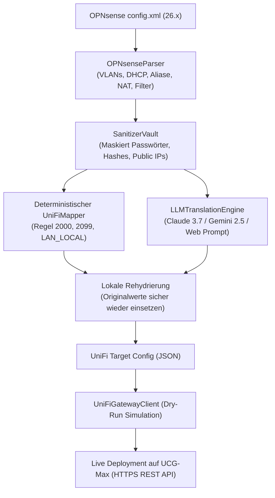

# OPNsense (26.x) zu UniFi Cloud Gateway Max (UCG-Max) Migration Suite

[](https://www.python.org/)
[](#benutzeroberfl%C3%A4chen)
[](#installation--voraussetzungen)
[](#2-datenschutz-tresor--llm-sanitization)

Eine ganzheitliche Python-Suite mit modernem **Web-Dashboard** und nativer **Desktop-GUI** zur automatisierten, verlustfreien Übertragung aller Netzwerkeinstellungen einer **OPNsense-Firewall (z.B. Version 26.7.5)** auf ein **Ubiquiti UniFi Cloud Gateway Max (UCG-Max)**.

Das Tool überbrückt die konzeptionellen Paradigmenwechsel zwischen FreeBSD/pf und UniFi OS, schützt sensible Anmeldedaten durch einen lokalen **Sanitization-Tresor** vor der Übertragung an LLMs (Claude / Gemini) und bietet einen praxisnahen Leitfaden für die Ablösung des bisherigen UniFi OS (UOS) Servers sowie den Austausch von Alt-Switches durch UniFi Lite/Pro PoE Switches.

---

## 📑 Inhaltsverzeichnis

- [Architektur & Migrationsablauf](#-architektur--migrationsablauf)
- [Konzeptionelle Unterschiede (OPNsense vs. UniFi)](#-konzeptionelle-unterschiede-opnsense-vs-unifi)
- [Datenschutz-Tresor & LLM-Sanitization](#-datenschutz-tresor--llm-sanitization)
- [Hardware- & Switch-Migrationsplan](#-hardware---switch-migrationsplan)
  - [Ziel-Netzwerktopologie](#ziel-netzwerktopologie)
  - [Port-Profile Best Practices](#port-profile-best-practices)
  - [Spanning Tree (STP/RSTP) & PoE-Budgets](#spanning-tree-stprstp--poe-budgets)
- [Benutzeroberflächen (Web-Dashboard & Desktop-GUI)](#-benutzeroberfl%C3%A4chen)
- [Installation & Voraussetzungen](#-installation--voraussetzungen)
- [Schnellstart](#-schnellstart)
- [Projektstruktur](#-projektstruktur)
- [Automatisierte Tests](#-automatisierte-tests)

---

## 🔄 Architektur & Migrationsablauf



---

## ⚖️ Konzeptionelle Unterschiede (OPNsense vs. UniFi)

Die größte Gefahr beim Umstieg von OPNsense auf UniFi liegt in der **Umkehrung der standardmäßigen Sicherheitslogik**:

| Komponente | OPNsense (FreeBSD `pf`) | UniFi Cloud Gateway Max (UniFi OS) | Lösung durch diese Suite |
| :--- | :--- | :--- | :--- |
| **Inter-VLAN Standardverhalten** | **Default Deny:** Verkehr zwischen Schnittstellen ist standardmäßig verriegelt. | **Default Allow:** Alle Corporate-VLANs dürfen standardmäßig frei miteinander kommunizieren! | **Automatische Schutzinjektion:**<br>1. Regel 2000 (`LAN_IN`): `Allow Established/Related`<br>2. Pinholes (2002–2080): Ausnahmen<br>3. Regel 2099 (`LAN_IN`): `Block All Inter-VLAN (RFC1918 zu RFC1918)` |
| **Internet-Zugriff für isolierte Netze** | Ein Interface ohne `pass ... to any` Regel hat **kein Internet**. | Da RFC1918-Block nur private IPs betrifft, würde Internet (`8.8.8.8`) standardmäßig durchfließen! | **Internet-Default-Deny:** Erkennt OPNsense-Netze ohne Internet-Regel und injiziert gezielte `Drop to Any`-Regeln auf `LAN_IN`. |
| **Gateway-Zugriffsschutz** | Unprivilegierte Netze können die Firewall-GUI nicht öffnen. | Das UCG-Max WebGUI (Port 443/80) und SSH (Port 22) lauschen auf allen Gateway-IPs. | **`LAN_LOCAL`-Härtung:** Erlaubt DNS (Port 53) und DHCP (Port 67); sperrt WebGUI/SSH für unprivilegierte VLANs. |
| **Aliase** | Verschachtelt, URLs, FQDNs, Ports und IPs gemischt. | Strikte Trennung in `address-group` (IP/CIDR) und `port-group` (Ports). | Automatische Aufteilung und rekursive Entschachtelung. |
| **Feste IPs (DHCP)** | Pro Schnittstelle in `<dhcpd>` oder Kea definiert. | Zentral an Client-Geräte gebunden (`/rest/user`). | Mappt MAC-Adressen, Hostnamen und statische IPs auf UniFi-Client-Objekte. |
---

## 🔍 100% Lokale Migration & Transparenz-Audit

### Findet eine lokale Migration statt?
**Ja, die gesamte Migration erfolgt zu 100% lokal auf Ihrem Rechner und in Ihrem lokalen Netzwerk:**
* **Lokaler Webserver:** Das Dashboard läuft ausschließlich unter `http://127.0.0.1:8080` (bzw. als native Desktop-App).
* **Lokale Berechnungen:** Das Parsen der XML, die Subnetz-Berechnungen und die Erzeugung der UniFi-Regeln finden offline statt.
* **Direkte Gateway-Kommunikation:** Das Deployment kommuniziert über das lokale LAN direkt mit der REST-API Ihres UCG-Max (`https://192.168.1.1`) – ohne Ubiquiti Cloud, Drittserver oder Telemetrie.
* **LLM ist komplett optional:** Die deterministische Übersetzungs-Engine funktioniert vollständig offline ohne KI. Falls Sie Claude oder Gemini nutzen, werden zuvor alle Passwörter und öffentlichen IPs lokal maskiert.

---

### Was wird übertragen – und was NICHT?

Die Software trennt sauber zwischen automatisierbaren Netzwerkobjekten und plattformspezifischen Sonderfunktionen und listet alle nicht-migrierbaren Elemente in einer eigenen **Audit-Tabelle** mit konkreten Handlungsempfehlungen auf:

| Bereich | Was WIRD automatisch übertragen? | Was wird NICHT übertragen? (Plattform-Unterschied) | Handlungsempfehlung in UniFi OS |
| :--- | :--- | :--- | :--- |
| **Netzwerk & VLANs** | Alle VLAN-IDs, Subnetze, Gateway-CIDRs, DHCP-Bereiche & DNS-Server. | *(Vollständig übertragen)* | Keine manuelle Aktion nötig. |
| **DHCP-Reservierungen** | Alle festen Leases (MAC, IP, Hostname, Beschreibung). | *(Vollständig übertragen)* | Werden direkt als Client Fixed-IPs angelegt. |
| **DNS-Records (Unbound)** | DHCP-Hostnamen sowie **Unbound DNS Host Overrides** (A-Records, FQDNs). | *(Vollständig übertragen)* | Werden automatisch via `/rest/dnsrecord` angelegt. |
| **Port Forwarding (NAT)** | Alle TCP/UDP Port-Weiterleitungen auf interne Ziel-IPs. | 1:1 NAT oder komplexe Outbound-Pool-Mappings. | UniFi führt Outbound-NAT (Masquerade) auf WAN automatisch aus. |
| **Firewall & Traffic Rules** | Alle Filterregeln auf LAN/VLANs, Default-Deny-Schutz, LAN_LOCAL Gateway-Schutz, sowie **URL-/GeoIP-Aliase als Traffic Rules**. | **Floating Rules** & pf-spezifische `out`-Regeln. | UniFi filtert auf `LAN_IN`. Manuelle Sonderregeln bei Bedarf als Traffic Rule anpassen. |
| **Aliase** | Alle Host-, Netzwerk- und Port-Aliase (automatisch entschachtelt) + URL-Table/GeoIP Aliase. | *(Vollständig übertragen)* | Keine manuelle Aktion nötig. |
| **VPN-Dienste** | **WireGuard Server-Blueprint** (Listen-Port, Server-Subnetz, Peer-Vorlagen). | **OpenVPN & IPsec Tunnel** (Architektur-Inkompatibilität). | WireGuard wird vorbereitet; OpenVPN/IPsec in UniFi OS unter *Settings > VPN* oder per Teleport (1-Klick) nutzen. |
| **Bandbreitenbegrenzung**| **Traffic Shaper Pipes & CoDel Limiter** werden automatisch in **UniFi Smart Queues (WAN Up/Down Limits)** übersetzt. | Queue-Scheduling-Gewichtungen (Fair-Queueing). | Smart Queues regeln Bufferbloat im UCG-Max hardwarenah. |
| **Routing / Multi-WAN** | Standard-Routing über WAN. | **Policy-Based Routing (Gateway-Overrides in Filterregeln).** | In UniFi unter *Settings > Routing > Policy-Based Routes* (Traffic Routes) anlegen. |
| **System & Benutzer** | *(Prinzipbedingt nicht übertragbar)* | **FreeBSD-Benutzerkonten & OPNsense-Plugins (Zenarmor, HAProxy).** | Benutzer unter *Admins & Users* einladen; IDS/IPS unter *Settings > Security > CyberSecure* aktivieren. |

---

## 🛡️ Datenschutz-Tresor & LLM-Sanitization

Wenn komplexe Regelwerke durch ein KI-Modell (z.B. Anthropic Claude 3.7 Sonnet oder Google Gemini 2.5) analysiert oder übersetzt werden sollen, sorgt der integrierte **Sanitizer-Tresor (`src/sanitizer/masker.py`)** für absolute Vertraulichkeit:

1. **Vollständige Maskierung vor der Übertragung:**
   - **Bcrypt-/MD5-Hashes & Passwörter:** Werden zu Tokens wie `__SECRET_PASS_001__`.
   - **Kryptografische Schlüssel & Zertifikate:** (WireGuard, OpenVPN, SSL-Zertifikate) werden zu `__CERT_KEY_001__`.
   - **Öffentliche WAN-IPs & FQDNs:** Werden zu `__PUB_IP_001__` tokenisiert (private Subnetze wie `192.168.x.x` bleiben für korrekte CIDR-Berechnungen lesbar).
   - *Optional:* MAC-Adressen können ebenfalls anonymisiert werden (`__MAC_ADDR_001__`).
2. **Reversibler lokaler Tresor:**
   - Die Zuordnungstabelle verlässt Ihren Rechner zu keinem Zeitpunkt.
   - Nach Rückgabe der strukturierten Antwort durch das LLM werden alle Platzhalter lokal verlustfrei wieder durch die Originalwerte ersetzt.
3. **Zwei Betriebsmodi:**
   - **Direkte API:** Ausführung mit eigenem API-Key für Gemini oder Claude.
   - **Offline / Web-Chat Modus:** Generiert einen fertig formatierten Prompt zum Kopieren in ChatGPT / Claude / Gemini Web inklusive 1-Klick-Rückimport der JSON-Antwort.

---

## 🔌 Hardware- & Switch-Migrationsplan

### Ziel-Netzwerktopologie

```mermaid
flowchart TD
    WAN["Internet (Glasfaser / Kabel-Modem)"] -->|2.5G WAN| UCG["UniFi Cloud Gateway Max (UCG-Max)<br>Router + Firewall + UniFi OS Controller"]
    
    subgraph Neuer UniFi Switch-Kern
        UCG -->|2.5G LAN Trunk| USW["UniFi Switch Pro / Lite PoE<br>(Zentraler PoE-Switch)"]
        
        USW -->|PoE+ / Trunk| AP1["UniFi AP 1"]
        USW -->|PoE+ / Trunk| AP2["UniFi AP 2"]
        USW -->|PoE / VLAN 30| CAM1["Protect Kamera (Eingang)"]
        USW -->|PoE / VLAN 30| CAM2["Protect Kamera (Garten)"]
        USW -->|VLAN 10| NAS["TrueNAS / Server"]
        USW -->|VLAN 10| HA["Home Assistant Core"]
    end

    subgraph Verbleibende Alt-Switches (Mischbetrieb)
        USW -->|Uplink Port| OLD_SW["Bestehende Switches<br>(Büro, Hobbyraum etc.)"]
        OLD_SW --> END_DEV["Kabelgebundene PCs / Drucker"]
    end
```

### Port-Profile Best Practices

In UniFi wird 802.1Q-VLAN-Tagging über **Port-Profile** geregelt:

| Anschlusstyp | Zielgeräte | Native VLAN (PVID) | Tagged VLANs | PoE-Status |
| :--- | :--- | :--- | :--- | :--- |
| **Uplink UCG-Max** | UCG-Max LAN | **Default (1)** | **Allow All** | Aus |
| **UniFi Access Points** | U6-Pro, U7-Pro APs | **Default (1)** | **Allow All** (für Multi-SSID) | **PoE+ aktiv** |
| **Protect Kameras** | G4/G5 Bullets, Domes | **CAMERAS (30)** | **Block All** (Client Isolation) | **PoE aktiv** |
| **Server & Storage** | NAS, Home Assistant | **SERVERS (10)** | Keine (oder Trunk bei VMs) | Aus |
| **Smart-Home-Bridges** | Philips Hue, Tado | **IOT_SMARTHOME (20)** | **Block All** | Aus |
| **Alt-Switch (Unmanaged)**| 5-Port Switch Schreibtisch| **MANAGEMENT (1)** | **Block All** | Aus |
| **Alt-Switch (Managed)** | HP/Netgear VLAN-Switch | **Default (1)** | **Benötigte VLANs taggen** | Aus |

### Spanning Tree (STP/RSTP) & PoE-Budgets

1. **RSTP Bridge Priority festlegen:**
   - In Misch-Umgebungen mit alten Switches oder Sonos-Lautsprechern kann es zu Netzwerkschleifen und Port-Blockaden kommen.
   - **Empfehlung:** Setzen Sie den neuen UniFi Haupt-Switch unter *Device &gt; Settings &gt; Spanning Tree* auf die Priorität **`4096`** oder **`8192`** (Root Bridge). Alle nachgelagerten Switches behalten `32768`.
2. **PoE-Budgetierung:**
   - **UniFi Switch Lite 16 PoE:** 45W PoE-Gesamtbudget auf 8 Ports (ausreichend für 2 APs und 2–3 sparsame Kameras).
   - **UniFi Switch Pro 24 PoE:** 400W Budget mit PoE+ (802.3at) und PoE++ (802.3bt) sowie 10G SFP+ Uplinks (ideal für WiFi 7 APs und PTZ-Kameras).
3. **Schrittweiser AP-Umzug:**
   - Schließen Sie die APs an die neuen PoE-Ports an (PoE-Injektoren entfallen).
   - Ändern Sie die Inform-URL der APs auf das UCG-Max (`set-inform http://192.168.1.1:8080/inform`) oder nutzen Sie das Site-Backup des alten UOS-Servers.
   - Sobald alle APs im UCG-Max grün leuchten, schalten Sie den alten UOS-Server ab.

---

## 🖥️ Benutzeroberflächen

Die Suite bietet zwei Optionen zur Bedienung:

### 1. Web-Dashboard (Empfohlen)
Startet einen lokalen Server auf `http://127.0.0.1:8080` mit 6 interaktiven Modulen:
- **Tab 1: Import & OPNsense-Analyse:** Drag & Drop für `config.xml` mit automatischer Erkennung von VLANs, DHCP-Leases, Aliasen, NAT und Filterregeln.
- **Tab 2: Datenschutz & Anonymisierung:** Live-Audit aller maskierten Geheimnisse und Vorschau des bereinigten Datensatzes.
- **Tab 3: LLM Regel-Übersetzer:** Prompt-Generator, API-Trigger für Claude/Gemini und Offline-JSON-Import.
- **Tab 4: UniFi Konfig Review & Editor:** Tabellen für Netzwerke, Firewall-Regeln, Firewall-Gruppen, Fixed-IPs und Port-Forwards.
- **Tab 5: UCG-Max Rollout:** Verbindungstest, **Dry-Run-Simulation** (zeigt exakt, was angelegt wird, ohne Hardware zu verändern) und Live-Deployment.
- **Tab 6: APs & Switch Roadmap:** Schritt-für-Schritt-Leitfaden für die physische Migration.

### 2. Native Desktop-GUI (`gui_desktop.py`)
Eine leichtgewichtige Tkinter-Desktop-Oberfläche zum schnellen Öffnen von Konfigurationsdateien, Betrachten der Metriken und Exportieren von UniFi-JSON-Dateien.

---

## 📦 Installation & Voraussetzungen

### Voraussetzungen
- Python **3.12** oder **3.13**
- Git

### Abhängigkeiten installieren
Die Suite nutzt standardmäßig Pakete aus der Python-Standardbibliothek sowie die bereits im System verfügbaren Module:
```powershell
pip install starlette uvicorn requests lxml cryptography
```

---

## 🚀 Schnellstart

### 1. Web-Dashboard starten
```powershell
py -3.13 main.py
```
*Der Standardbrowser öffnet sich automatisch unter `http://127.0.0.1:8080`.*

### 2. Demo-Daten testen
Klicken Sie im Dashboard oben rechts auf **"Demo-Daten laden"**, um sofort ein realistisches Szenario mit 5 VLANs (Management, Server, IoT, Kameras, Gäste), 8 festen DHCP-Leases, Port-Forwards und Firewall-Regeln zu durchlaufen.

### 3. Native Desktop-GUI starten
```powershell
py -3.13 gui_desktop.py
```

---

## 📁 Projektstruktur

```text
opnsense2ucg-converter/
├── examples/
│   └── sample_opnsense_26_7_5.xml     # Realistische OPNsense 26.7.5 Testkonfiguration
├── src/
│   ├── gui/
│   │   ├── templates/
│   │   │   └── index.html            # Reaktives Web-Dashboard (Tailwind & FontAwesome)
│   │   └── app.py                    # Starlette REST-API & Session-Controller
│   ├── llm/
│   │   └── engine.py                 # LLM-Schnittstelle (Claude, Gemini & Prompt-Export)
│   ├── opnsense/
│   │   └── parser.py                 # XML-Parser für OPNsense (VLANs, Kea/ISC, Filter, NAT)
│   ├── sanitizer/
│   │   └── masker.py                 # Datenschutz-Tresor (Reversible Maskierung von Secrets)
│   ├── translator/
│   │   └── mapper.py                 # UniFi-Regel-Synthesizer mit Default-Deny-Emulation
│   ├── unifi/
│   │   └── client.py                 # UCG-Max REST-Client mit Dry-Run & Deployment
│   └── models.py                     # Normalisierte Datenstrukturen
├── tests/
│   ├── test_pipeline.py              # Unit-Tests für Parser, Sanitizer und Mapper
│   └── test_api.py                   # Integrationstests für API-Endpoints und Rollout-State
├── .gitignore
├── gui_desktop.py                    # Native Desktop-GUI (Tkinter)
├── main.py                           # Hauptstarter (Webserver + Auto-Browser)
└── README.md                         # Diese Dokumentation
```

---

## 🧪 Automatisierte Tests

Führen Sie die integrierte Testsuite aus:

```powershell
py -3.13 tests/test_pipeline.py
py -3.13 tests/test_api.py
```

Ergebnis:
```text
SUCCESS: All unit tests passed!
SUCCESS: Core workflow and state tests passed cleanly!
```

---

## 🔒 Sicherheitshinweis

Führen Sie vor dem Live-Deployment auf ein produktives Gateway immer zuerst den **Dry-Run (Simulation)** aus und sichern Sie die bestehende Konfiguration Ihres UniFi Cloud Gateway Max über die Weboberfläche unter *Settings &gt; System &gt; Backups*.
